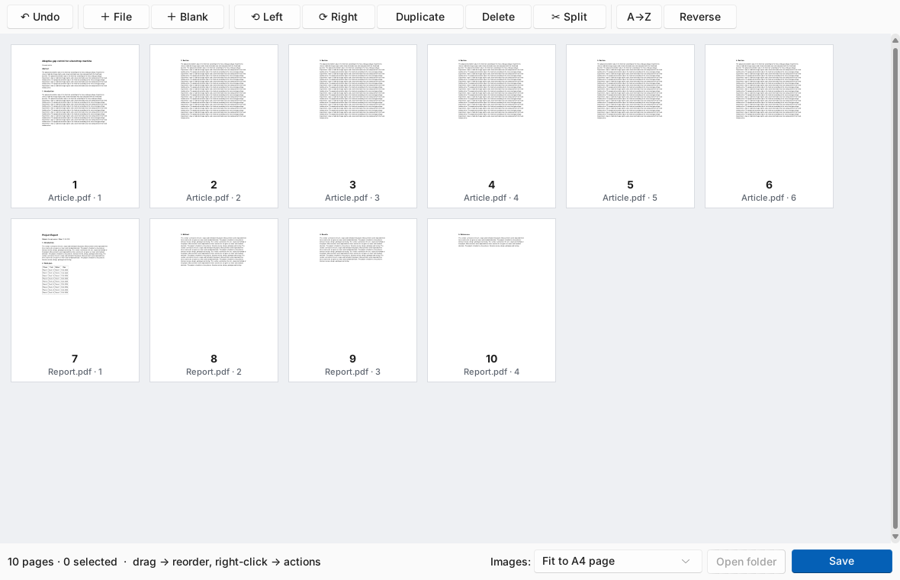
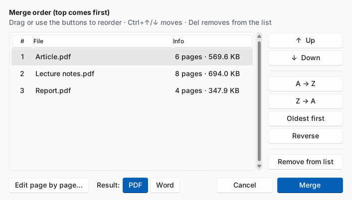
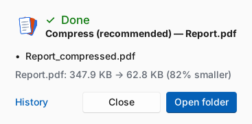
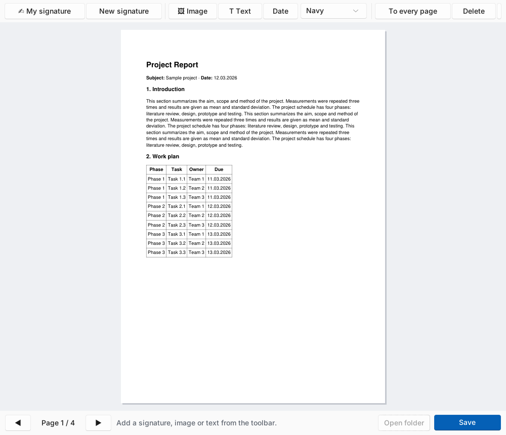
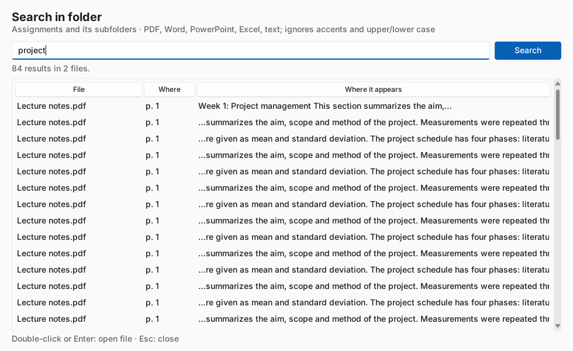
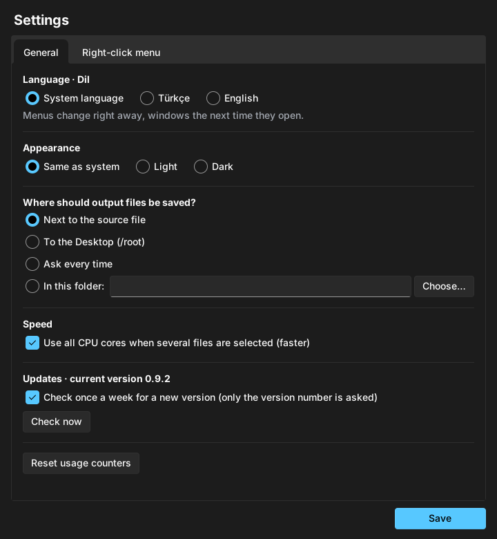
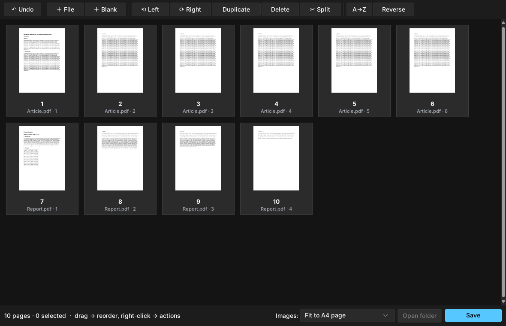

# Riffle — right-click PDF & document tools

**🇬🇧 English** · [🇹🇷 Türkçe](README.tr.md)

[](https://github.com/halil-tuna/riffle/actions/workflows/windows-exe.yml)
[](LICENSE)

The everyday tools of online PDF sites (merge, split, compress, convert, sign, OCR…) — **offline, free and
without limits**, straight from the **right-click menu** of Windows 11 and Linux Mint (Nemo).
Your files never leave your computer.

> **English and Turkish interface.** Riffle follows your system language; switch it any time in
> *Settings → Language*. Menus, windows, messages, output file names and the installer are all translated.



## Highlights

- **62 tools in the context menu** — select files, right-click, done. Multiple selection works everywhere
  (Windows launches one process per file; Riffle gathers them into one job).
- **PDF → Word that keeps the layout** — built on pdf2docx with a large repair layer: table widths, two-column
  articles, lost symbol fonts (μ, α, β recovered from glyph names), hyphenation, sub/superscripts, rules and
  page flow. Highlights and pen marks (ticks, underlines) come along, and notes written on the PDF become real
  Word comments on the text they refer to. Slides and two-column papers get an
  exact-layout mode with editable text boxes.
  Measured with a round-trip benchmark (PDF → Word → PDF, text + visual + page score):
  **98.0 / 100** average over a mixed corpus of reports, articles, slides, tables, scanned pages and
  handwritten notes, and **98.0** on a second set of real-world documents collected separately.
- **Scanned documents** — Tesseract OCR with automatic cleanup for shadowed, faded or phone-photographed
  pages, deskew, table reconstruction, and font size / bold detection so the Word output looks like the scan.
- **Page organizer** — thumbnails of PDFs, images (incl. iPhone HEIC) and Office files together; drag to
  reorder, rotate, delete, duplicate, insert blanks, split into several PDFs, drop files in from Explorer.
- **Sign / stamp** — draw your signature once or photograph it on paper (background removed), add text,
  dates and logos, apply to every page.
- **Fill PDF forms**, **redact personal data** (real removal; Turkish ID and IBAN validated by checksum),
  **compare two PDFs**, **search inside a folder** (PDF, Word, PowerPoint, Excel, text; accent-insensitive),
  **photo → scanned document** (corner detection, true-aspect perspective correction),
  **compress to a target size** (e.g. under 2 MB), **split by size** (e.g. 10 MB parts for e-mail),
  **make all pages A4** (mixed Letter/A5/phone scans/slides fitted and centred, text stays vector), **PDF/A**, **PDF → Markdown**, print layouts (2/4/6-up,
  booklet, grayscale) and more.
- **Word, Excel, PowerPoint and images, too** — Excel → PDF fits wide sheets to the page width (landscape when
  needed) instead of cutting columns onto extra pages; shrink Office files by recompressing their pictures (photo-heavy
  decks fit in an e-mail again), merge Word documents into one .docx (styles, images and numbered lists kept),
  turn CSV files into clean Excel sheets (encoding and delimiter detected; `1.234,56` and `1,234.56` numbers,
  European and US dates — ambiguous ones left as text; IDs and leading-zero numbers kept as text), slide handouts with note lines, extract pictures; for images: OCR straight to the clipboard (equations and figures it cannot read are marked, not silently dropped),
  shrink to a target size (e.g. under 200 KB), PNG, rotate.
- **Fast** — Office files are converted in a single LibreOffice call with a persistent profile; large jobs use
  every CPU core; long PDF → Word conversions are split into page chunks and run in parallel. Every job can be
  cancelled without leaving half-written files.
- **Native look** — Windows 11 style (Sun Valley theme), follows the system light/dark mode, dark title bar.
- **Update notice** — once a week Riffle asks GitHub for the latest version number (nothing else is sent) and
  shows a link when a newer release exists; can be turned off in Settings.

| | |
|---|---|
|  |  |
|  |  |
|  |  |

## Install

### Windows 10 / 11 — installer

Download `Riffle-<version>-setup.exe` from **[Releases](https://github.com/halil-tuna/riffle/releases)**
and run it (no admin rights needed). The context-menu entries are added automatically and removed on
uninstall. On Windows 11 they are under **Show more options** (Shift+F10).

Optional components (links on the last installer page):
[LibreOffice](https://www.libreoffice.org/download) for Word/Excel/PowerPoint → PDF,
[Tesseract](https://github.com/UB-Mannheim/tesseract/wiki) for OCR (tick *Turkish* in *Additional language
data*), [Ghostscript](https://ghostscript.com/releases/gsdnld.html) for PDF/A.
`Riffle.exe --check` shows what is available.

The installer is unsigned, so SmartScreen may warn on first run: *More info → Run anyway*.

### Linux Mint (Cinnamon / Nemo)

```bash
sudo apt install python3-venv python3-tk libreoffice-core tesseract-ocr tesseract-ocr-tur
git clone https://github.com/halil-tuna/riffle.git ~/Tools/riffle
cd ~/Tools/riffle && python3 install.py
nemo -q
```

### Windows from source

Install Python 3.10+ (tick *Add python.exe to PATH*), put this folder somewhere permanent, then run
`python install.py` in it.

## Command line

```
python run.pyw --list                    # all tools and their ids
python run.pyw compress report.pdf
python run.pyw merge a.pdf b.pdf c.pdf
python run.pyw pdf2word paper.pdf
python run.pyw --settings
Riffle.exe --install-menu | --uninstall-menu | --check | --version
```

## Development

```
riffle/actions.py       tool catalogue (ACTIONS), core PDF tools, PDF → Word repair layer
riffle/textfix.py       PDF text repair (symbol fonts, hyphenation, subscripts)
riffle/reflow.py        figure recovery, page flow, Word section rules, horizontal rules
riffle/fixed_layout.py  exact-layout DOCX (slides, two-column papers)
riffle/ocr.py           Tesseract OCR, image cleanup, table rules, scanned-page rebuild
riffle/scan.py          photo → document (corners, perspective, lighting)
riffle/tools.py         page tools, numbering, watermark, Excel, PowerPoint, images
riffle/docops.py        redaction, compare, crop, Markdown, PDF/A, print layouts, deskew
riffle/organizer*.py    page organizer (model + window)
riffle/stamp*.py        signature / text / image placement (model + window)
riffle/officetools.py   Office shrink, Word merge, CSV → Excel, slide handouts, Office pictures
riffle/imagetools.py    image OCR, target size, PNG, rotate
riffle/update.py        weekly update notice (GitHub Releases)
riffle/forms.py         form filling        riffle/search.py   folder search
riffle/settings.py      settings, favourites, output folder, appearance
riffle/i18n.py          languages: T("…") wrapper, system-language detection, setting
riffle/i18n_en.py       English catalogue (source strings are Turkish; tests/i18n_scan.py lists missing ones)
riffle/theme.py         shared look: Windows 11 theme, light/dark, colours, icon
riffle/parallel.py      parallel batches, chunked PDF → Word, cancellation
riffle/ui.py            progress, order and input dialogs (tkinter)
install.py              Windows registry menus + Nemo actions (also used by the .exe)
packaging/              PyInstaller build (+ pruning of unused files), Inno Setup script, screenshots
.github/workflows/      tests + Windows installer on every push; release on version tags
bench/bench.py          PDF → Word quality benchmark
tests/                  ~250 automated tests (incl. real windows under Xvfb)
```

Adding a tool: a function in `tools.py` / `docops.py` plus one line in `ACTIONS`; menus are generated.

- **Tests:** `python -m pytest tests` · window tests on Linux: `xvfb-run -a python -m pytest tests/test_ui.py`
- **Benchmark:** `python bench/bench.py <pdf_folder> --engine app --out results` — scores each PDF's
  PDF → Word → PDF round trip (text / visual / pages) and lists Word-specific risks.
- **Package:** `pip install pyinstaller && python packaging/build_exe.py` → `dist/Riffle/`, then
  `iscc packaging\installer.iss` on Windows. Pushing a `v*` tag builds and publishes the installer.

### Translations

Every user-visible string is wrapped as `T("…")` with the Turkish text as the key; `riffle/i18n_en.py` maps it
to English. `python tests/i18n_scan.py` lists strings without a translation, and the test suite fails on
untranslated or unwrapped UI strings, mismatched placeholders, or Turkish characters in the English menus.
Code comments and docstrings are in English; only the `T("…")` keys (and a few Turkish examples, e.g. for
the CSV and search heuristics) are Turkish.

## Known limits

- Windows 11 shows the menu under *Show more options* (the new top-level menu needs a signed package).
- Explorer shows at most 16 rows per static submenu, so the PDF menu is split into a few entries;
  hiding unused tools in Settings merges them again.
- No handwriting OCR (Tesseract is for print); handwritten pages stay as images in Word.
- OCR does not read equations; their places are marked in the extracted text.
- The signature tool places a visual signature, not a cryptographic e-signature.

## License

**GNU Affero General Public License v3.0** — see [`LICENSE`](LICENSE).

Components: PyMuPDF (AGPL-3.0), pdf2docx (MIT), pymupdf4llm (AGPL-3.0), Pillow (MIT-CMU),
python-pptx (MIT), openpyxl (MIT), pillow-heif (BSD-3) / libheif (LGPL-3.0), opencv-python-headless
(Apache-2.0), tkinterdnd2 (MIT), sv-ttk (MIT), darkdetect (BSD-3), docxcompose (MIT), babel (BSD-3), pywin32 (PSF).
Font: Liberation Sans (SIL Open Font License 1.1, `riffle/fonts/OFL.txt`).
External programs: LibreOffice (MPL-2.0), Tesseract (Apache-2.0), Ghostscript (AGPL-3.0).
