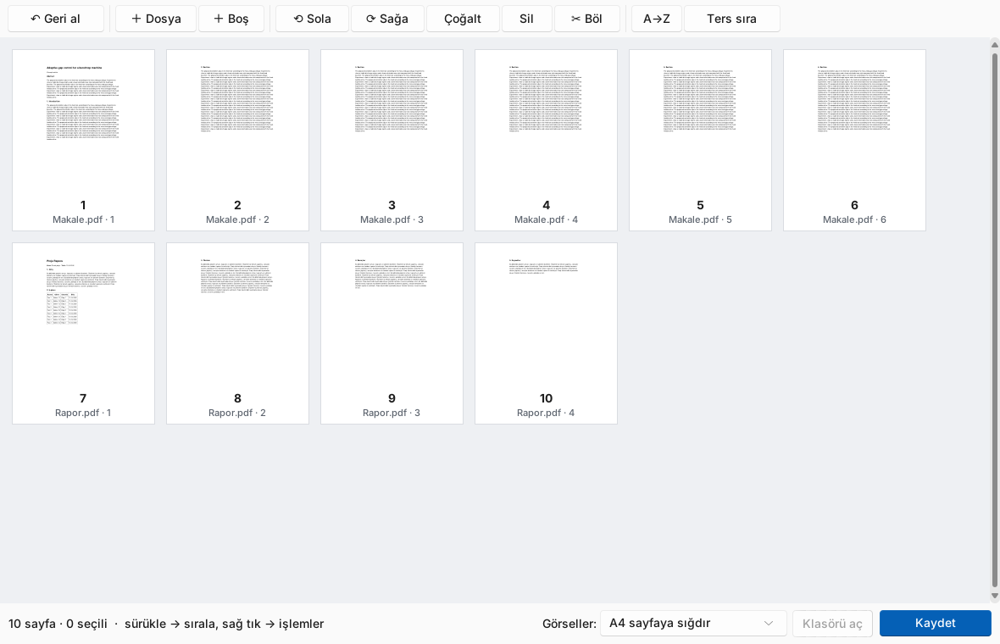

# Riffle — sağ tıkta PDF ve belge araçları

[🇬🇧 English](README.md) · **🇹🇷 Türkçe**

iLovePDF'in araçları, internetsiz ve ücretsiz, doğrudan **sağ tık menüsünden**.
Dosyaların bilgisayarından çıkmaz, sınır yok. Windows 11 ve Linux Mint (Cinnamon/Nemo, masaüstü dahil).



## Araçlar

### Sayfa düzenleyici — "Sayfaları düzenle / birleştir…"

PDF, görsel (iPhone HEIC dahil) ve Word/Excel/PowerPoint dosyalarını **birlikte** seçip sağ tıkla.
Birden çok dosyada önce **küçük sıralama penceresi** anında açılır (sayfalar yüklenmez): sırayı ayarla,
**Birleştir** de — bitti. Sayfa sayfa iş gerekiyorsa **Sayfa sayfa düzenle…** ile düzenleyiciye geç
(tek dosyada doğrudan düzenleyici açılır). Düzenleyicide bütün sayfalar küçük resim olarak açılır:

- **Sürükle-bırak** ile sırala; Ctrl / Shift ile birden çok sayfa seç
- **Döndür** (sola / sağa / 180°), **sil**, **çoğalt**, araya **boş sayfa** ya da **başka dosya** ekle
- **✂ Böl**: işaretlediğin yerlerden ayrı PDF'ler olarak kaydeder (`…_1.pdf`, `…_2.pdf`)
- Görseller A4 sayfaya sığdırılır ya da kendi boyutunda kalır
- **Çift tık**: sayfanın büyük önizlemesi (←/→ gez, R/L döndür, Del sil, Esc kapat)
- **Gezgin'den sürükle-bırak**: dosya ya da klasörü pencereye bırak, bıraktığın yere eklenir
- **Kaydet**: kaynakların yanına `…_birlesik.pdf`; asıl dosyalara dokunulmaz

Kısayollar: Ctrl+A tümü · Del sil · Ctrl+R sağa · Ctrl+L sola · Ctrl+D çoğalt · Ctrl+B böl ·
Ctrl+Z geri al · Ctrl+←/→ taşı · Ctrl+S kaydet · sağ tık: işlem menüsü.

### İmza / yazı / logo ekle

PDF'e sağ tık → **İmza / yazı / logo ekle…**. Sayfa büyük açılır:

- **✍ İmzam**: imzanı bir kez fareyle çiz ya da beyaz kâğıda attığın imzanın **fotoğrafını** yükle —
  arka plan silinir, şeffaf imza olarak saklanır; sonraki belgelerde tek tık
- **🖼 Görsel** (logo, kaşe, fotoğraf) · **T Yazı** · **Tarih** (bugün) · renk seçimi
- Sürükle: taşı · sağ alt köşe: büyüt/küçült (oran korunur) · çift tık: yazıyı düzenle · Del: sil
- **Her sayfaya**: seçili öğeyi tüm sayfalara kopyalar (paraf, antet, logo)
- Döndürülmüş sayfalarda da doğru yerde ve dik durur. Çıktı: `…_imzali.pdf`

Kısayollar: Ctrl+I imzam · Ctrl+D tarih · Ctrl+G her sayfaya · PageUp/PageDown · ok tuşları · Ctrl+Z · Ctrl+S.

### Form doldur

Doldurulabilir PDF'e (dilekçe, staj/burs formu) sağ tık → **Formu doldur…**. Bütün alanlar tek pencerede
alt alta: yazı, onay kutusu, seçim listesi, radyo düğmesi; etiketler formdaki açıklamadan ya da alanın
yanındaki yazıdan alınır. Türkçe karakterler doğru görünür. **Düzleştir** seçilirse alanlar düz yazıya
dönüşür, sonradan değiştirilemez. Çıktı: `…_doldurulmus.pdf`.

### Yazdır

**2 / 4 / 6 sayfayı 1 kâğıda** (slayt ve ders notu için; kâğıt yönü ve ızgara sayfa oranına göre kendiliğinden
seçilir), **Kitapçık yap** (çift taraflı, kısa kenardan çevir, ortadan katla-zımbala), **Siyah-beyaz yap**
(yazı, çizim ve resimler gri; metin seçilebilir kalır, dosya küçülür).

### Taranmış belgeler

- **Taramayı düzelt:** eğik taranmış sayfaları düzler (kayıpsız: resim yeniden sıkıştırılmaz) ve tarayıcıdan
  gelen boş arka yüzleri siler.
- **Boş sayfaları sil**, **İçindeki resimleri çıkar** (orijinal kalite, aynı resim bir kez, küçük ikonlar atlanır).
- **OCR:** gölgeli, soluk ya da telefonla çekilmiş sayfalarda görüntü önce temizlenir (ışık farkı, gürültü);
  temiz taramalarda ek süre yok. Deneme: gölgeli sayfada %84 → %100, soluk fotokopide %0 → %99 kelime.

### Word, Excel ve PowerPoint araçları

- **Küçült (içindeki resimleri sıkıştır):** .docx / .pptx / .xlsx içindeki fotoğraflar küçültülüp sıkıştırılır;
  fotoğraflı sunumlar e-postaya ve OBS'ye sığar. Saydam resimler ve çizimler net kalır, dosya açılabilir mi
  diye kaydetmeden önce denetlenir. Çıktı: `…_kucuk.pptx`.
- **Word belgelerini birleştir (Word olarak):** grup ödevinde ayrı yazılmış bölümler sıra penceresinde dizilir
  ve tek .docx olur; biçimler, resimler, numaralı listeler korunur, her belge yeni sayfadan başlar.
- **CSV → Excel (karakterler, sayılar, tarihler düzgün):** kodlama (UTF-8, Türkçe ya da Batı Avrupa Windows)
  ve ayırıcı (`;` `,` sekme) tanınır. Sayılar her iki yazımda da (`1.234,56` ve `1,234.56`) sayıya, tarihler
  (`03.11.2026`, ABD'nin `12/25/2026`'sı) tarihe çevrilir; gün mü ay mı belli olmayan `03/11/2026` gibi
  tarihler yanlış tarih üretmemek için metin kalır. TC kimlik, hesap no ve baştaki sıfırlı telefon numaraları
  metin kalır. Başlık satırı kalın ve sabit, filtre açık.
- **Not çıktısı (PowerPoint):** sayfada 3 slayt, yanlarında not satırları (A4); derste yazdırmak için.
- **İçindeki resimleri çıkar:** Word / PowerPoint / Excel'deki resimler orijinal kalitede bir klasöre.

### Görsel araçları

- **Görseldeki yazıyı çıkar (OCR → panoya):** ekran görüntüsü, slayt, tahta ya da belge fotoğrafındaki yazı
  okunur, panoya kopyalanır (Ctrl+V) ve yanına `.txt` olarak kaydedilir; satır ve paragraf düzeni korunur.
  Denklem, kesir ve şekiller okunamaz (yazı tanıma bunlar için değil): sessizce kaybolmasın diye metinde
  yerleri `[denklem / şekil — okunamadı]` ile işaretlenir. Tesseract gerekir.
- **Hedef boyuta indir:** "200 KB altına" gibi; başvuru formlarındaki fotoğraf/belge sınırları için en yüksek
  kaliteyi arar, gerekirse çözünürlüğü düşürür.
- **PNG'ye çevir · Sağa / sola döndür** (telefonun yön bilgisi dikkate alınır).

### Klasörde ara

Klasöre sağ tık → **Klasörde ara (dosyaların içinde)…**. PDF, Word, PowerPoint, Excel ve metin dosyalarının
içinde arar; Türkçe harf ve büyük/küçük farkı gözetmez ("ogrenci" → "ÖĞRENCİ"). Sonuçta dosya, sayfa/slayt/
hücre ve geçtiği cümle; çift tıkla dosya açılır. Metni olmayan taranmış PDF'leri ayrıca söyler.

### Kişisel bilgileri karart

**TC kimlik no** (kontrol hanesiyle doğrulanır, rastgele 11 haneli sayılar karartılmaz), **IBAN**
(kontrol toplamıyla), **telefon**, **e-posta** otomatik bulunur; istersen ek kelimeler (isim, adres) yazarsın.
Gerçek karartma: metin dosyadan **silinir** (kopyalanamaz, aranamaz), altındaki resim pikselleri de temizlenir,
belge bilgileri (yazar, program) sıfırlanır. Taranmış sayfalarda önce OCR gerekir.

### İki PDF'i karşılaştır

İki PDF seç → **İki PDF'i karşılaştır**. Rapor PDF'i: özet sayfası (benzerlik, silinen/eklenen kelimeler,
değişiklik listesi) + her sayfa yan yana, silinenler **kırmızı**, eklenenler **yeşil**. Ada göre ilki eski sürüm
sayılır (`rapor_v1`, `rapor_v2`).

### Fotoğraftan belge

Telefonla çekilmiş kâğıt/form/tahta fotoğraflarına (HEIC dahil) sağ tık → **Fotoğraftan belge (taranmış PDF)**.
Kâğıdın köşeleri bulunur, perspektif düzeltilir (kâğıdın gerçek oranı kamera geometrisinden hesaplanır,
A4'e yakınsa tam A4'e oturtulur), gölge ve ışık farkı temizlenir, Tesseract varsa metin aranabilir olur.
Birden çok fotoğraf → tek PDF (ada göre sıralı).

### Klasörü tek PDF yap (yer imli)

Klasöre (ya da klasörün içinde boş alana) sağ tık → **Klasörü tek PDF yap (yer imli)**. İçindeki PDF,
görsel ve Office dosyaları alt klasörlerle birlikte doğal sırayla (Hafta 2 < Hafta 10) tek PDF olur.
Her dosya bir yer imi, her alt klasör bir üst yer imi; dosyaların kendi içindekiler tablosu korunur.
Çıktı klasörün yanına yazılır. Normal birleştirme ve sayfa düzenleyici de artık dosya başına yer imi ekler.

### Hedef boyuta sıkıştır

**2 MB altına indir · 5 MB altına indir · Hedef boyuta indir…** (ör. `1.5`, `500kb`). e-Devlet, OBS,
burs/staj başvurusu sınırları için: sınırın altında kalan **en yüksek kaliteyi** arar; gerekirse son çare
olarak sayfaları görüntüye çevirir (ve söyler). Hedefe inmek imkânsızsa açıkça belirtir.

### Tek tık araçları

**PDF** (Windows'ta alt menülere ayrılmış):

| Menü | Araçlar |
|---|---|
| (üstte) | Sayfaları düzenle / birleştir… · İmza / yazı / logo ekle… · Formu doldur… · sık kullandıkların |
| Dönüştür | PDF → Word · PDF → Word (birebir düzen) · PDF → Word (akan metin) · PDF → Excel (tablolar) · PDF → PowerPoint · PDF → JPG · PDF → Metin · İçindeki resimleri çıkar · PDF → Markdown · PDF/A'ya çevir (arşiv) · Taranmış PDF'i aranabilir yap (OCR) |
| Düzenle | PDF'leri birleştir · Sayfa numarası ekle · Filigran ekle · Sağa / sola döndür · Ters çevir (180°) · Beyaz kenarları kırp · İki PDF'i karşılaştır |
| Sayfalar | Her sayfayı ayrı PDF yap · Sayfa seç ve çıkar… · Sayfa sil… · Sayfa sırasını ters çevir · Boş sayfaları sil |
| Yazdır | 2 / 4 / 6 sayfayı 1 kâğıda · Kitapçık yap · Siyah-beyaz yap |
| Küçült / Onar | Sıkıştır (önerilen) · Çok sıkıştır (e-posta için) · 2 MB / 5 MB altına indir · Hedef boyuta indir… · Taramayı düzelt · Bozuk PDF'i onar |
| Güvenlik | Şifre koy · Şifreyi kaldır · Kişisel bilgileri karart… |

**Word / Excel / PowerPoint / ODT / RTF / TXT / CSV / HTML:** PDF'e çevir · Küçült · Word belgelerini birleştir ·
CSV → Excel · Not çıktısı · İçindeki resimleri çıkar
**Görseller (JPG, PNG, WEBP, BMP, TIFF, GIF, iPhone HEIC):** PDF'e çevir (çoklu seçim → tek PDF) · Fotoğraftan belge ·
Görseldeki yazıyı çıkar · JPG / PNG'ye çevir · Küçült · Hedef boyuta indir · Sağa / sola döndür
**Klasörler:** Klasörü tek PDF yap (yer imli) · Klasörde ara
**Her menünün sonunda:** Ayarlar…

### Ayarlar

Herhangi bir dosyaya sağ tık → **Ayarlar…** (ya da `python run.pyw --settings`):
- **Görünüm:** sistemle aynı (Windows koyu temadaysa Riffle da koyu) · açık · koyu. Pencereler Windows 11
  görünümünde (Sun Valley teması); koyu modda başlık çubuğu da koyulaşır.
- **Menüyü sadeleştir:** kullanmadığın araçları gizle; istediklerini en üste sabitle. En çok kullandığın
  3 işlem (en az 3 kez) kendiliğinden menünün en üstüne çıkar.
- **Çıktı yeri:** kaynağın yanına (varsayılan) · Masaüstüne · seçtiğin klasöre · her seferinde sor.
- **Güncellemeler:** haftada bir GitHub'da yeni sürüm var mı diye bakılır (yalnızca sürüm numarası sorulur,
  hiçbir dosya ya da bilgi gönderilmez); varsa iş bitince ekranında "Yeni sürüm var" bağlantısı çıkar.
  Kapatılabilir; *Şimdi denetle* düğmesi de var.
- **Paralel çalışma:** çok dosya seçince işlemcinin bütün çekirdekleri kullanılır; 30+ sayfalık PDF → Word
  sayfa parçalarına bölünüp paralel çevrilir (sonuç tek parça ile aynı).
- İlerleme penceresinde **İptal** (ya da Esc): biten dosyalar kalır, yarım dosya bırakılmaz; çalışan
  LibreOffice/Ghostscript de durdurulur.

- **Sıralama penceresi:** birden çok dosyayla *PDF'leri birleştir*, *görselleri PDF'e çevir*, *fotoğraftan
  belge* ya da *karşılaştır* seçince önce sıra sorulur: sürükle-bırak, ↑/↓, A→Z / Z→A, eskiden yeniye,
  ters çevir, listeden çıkar (Ctrl+↑/↓ taşır, Enter tamam). Sayfa sayfa düzenlemek için oradan
  *Sayfa sayfa düzenle…*.
- Word/Excel/PowerPoint dosyaları **tek LibreOffice çağrısında** çevrilir ve LibreOffice profili kalıcıdır
  (her dosyada programı yeniden açmak ve her seferinde yeni profil kurmak en yavaş kısımdı).
- Çıktı kaynağın yanına yazılır, **hiçbir dosyanın üstüne yazmaz** (`dosya (1).pdf`).
- Birden fazla dosya seçip tek tıkla hepsini işler; birleştirme doğal sırayla (`sayfa2` < `sayfa10`).
- Sayfa aralığı: `1-3, 5, 8-` · `tek` · `çift` · `son`.
- **PDF/A** (e-Devlet/UYAP/arşiv) için Ghostscript gerekir; **PDF → Markdown** ChatGPT/Claude'a ya da
  Notion/Obsidian'a yapıştırmak için başlık ve tabloları korur.

### PDF → Word nasıl çalışıyor

Program belgenin türünü kendisi anlar:

- **Normal belgeler** (rapor, ödev, makale): akan, düzenlenebilir metin. pdf2docx'in üzerine yazdığımız
  düzeltme katmanı: tablo sütun genişlikleri, kesilen tablo satırları, taşan sayfa numaraları, madde
  işaretleri, iki sütunlu makaleler, boşluksuz eski PDF'ler, kırpılmış dergi sayfaları, kaybolan figürler,
  sayfa akışı (dolu biten sayfalarda metin akar, üst/alt bilgiler silinir; kasıtlı sayfa sonları korunur),
  Word'ün LibreOffice'ten farklı davrandığı bölüm/kenar boşluğu kuralları.
  Metin de onarılır: Unicode'u olmayan sembol fontlarındaki harfler (Elsevier makalelerindeki μs, α, β)
  glif adından kurtarılır; satır sonu tireleri birleşir (`devel-` + `oped` → `developed`) ama belgede tireli
  geçen birleşik kelimeler (`water-based`) korunur; TiO₂ gibi alt simgeler ve fi/fl bağlı harfleri düzelir.
  Başlık altı ve bölüm ayırıcı gibi yatay çizgiler paragraf kenarlığı olarak korunur.
- **Sunumlar ve iki sütunlu makaleler**: *birebir düzen* — arka plan resim, yazılar yerinde
  düzenlenebilir kutular; satırlar ve sayfa sonları orijinalle aynı kalır. Akan metin istersen
  **PDF → Word (akan metin)**, her belgeyi birebir istersen **PDF → Word (birebir düzen)**.
- **Taranmış sayfalar:** Tesseract kuruluysa Türkçe OCR ile düzenlenebilir metne; tablo çizgileri
  algılanıp gerçek Word tablosu kurulur. El yazısı ve güvenilmez OCR sonuçları sayfa resmi olarak kalır.
  Eğri taranmış sayfalar önce düzeltilir; yazı boyutu ve kalın yazılar taramadan ölçülüp aynen aktarılır.

## Kurulum — Windows 11 (kolay yol: kurulum dosyası)

GitHub'daki **Releases** sayfasından `Riffle-0.9.2-kurulum.exe`'yi indir, çalıştır (yönetici yetkisi
istemez). Sağ tık menüsü kendiliğinden eklenir; kaldırınca menü de silinir. Kurulumun son ekranındaki
bağlantılardan isteğe bağlı bileşenleri kur: LibreOffice (Office → PDF), Tesseract (OCR, *Turkish*'i işaretle),
Ghostscript (PDF/A).

Kurulum dosyası GitHub Actions'ta otomatik üretilir: depoya `v0.9.2` gibi bir etiket (tag) gönderince
`.github/workflows/windows-exe.yml` Windows'ta testleri çalıştırır, PyInstaller ile paketler, paketi gerçek bir
PDF'le dener, Inno Setup ile `…-kurulum.exe` yapar ve sürüme ekler. Elle de çalıştırılabilir
(Actions → *Windows kurulum dosyası* → *Run workflow*; çıktı *Artifacts* altında).

## Kurulum — Windows 11 (kaynaktan)

1. **Python 3.10+**: https://www.python.org/downloads/ — kurarken **"Add python.exe to PATH"** işaretle.
2. **LibreOffice** (Office → PDF için; MS Office kuruluysa gerekmez): https://www.libreoffice.org/download
3. **Tesseract** (taranmış PDF / OCR için, isteğe bağlı): https://github.com/UB-Mannheim/tesseract/wiki
   — kurulumda *Additional language data* altında **Turkish**'i işaretle.
4. Bu klasörü kalıcı bir yere koy (ör. `C:\Araclar\riffle`). Taşırsan kurulumu tekrar çalıştır.
5. Klasörde adres çubuğuna `cmd` yaz, Enter:
   ```
   python install.py
   ```
   Sonunda hangi ek bileşenlerin hazır olduğunu listeler.
6. Dosyaya sağ tık → **Daha fazla seçenek göster** (veya Shift+F10) → **Riffle**.

## Kurulum — Linux Mint

```bash
sudo apt install python3-venv python3-tk libreoffice-core tesseract-ocr tesseract-ocr-tur
cd ~/Araclar/riffle
python3 install.py
nemo -q
```
Dosyaya (masaüstünde de) sağ tık → **Riffle › …** satırları.

## Güncelleme / kaldırma

- Kurulum dosyasıyla: yeni sürümün kurulumunu çalıştır; kaldırmak için *Ayarlar → Uygulamalar*.
- Kaynaktan: yeni sürümü aynı klasörün üzerine aç, `python install.py --menu-only`.
  Kaldırma: `python install.py --uninstall`, sonra klasörü sil.

## Komut satırı

```
python run.pyw --list
python run.pyw compress rapor.pdf
python run.pyw merge a.pdf b.pdf c.pdf
python run.pyw extract rapor.pdf        # sayfa aralığını sorar
python run.pyw compare v1.pdf v2.pdf
Riffle.exe --install-menu | --uninstall-menu | --check | --version
```

## Geliştirme

```
riffle/actions.py       katalog (ACTIONS) + temel PDF araçları + PDF→Word düzeltme katmanı
riffle/tools.py         sayfa işlemleri, numara, filigran, OCR aracı, Excel, PowerPoint, görseller
riffle/reflow.py        figür kurtarma, sayfa akışı, Word bölüm kuralları
riffle/fixed_layout.py  birebir düzen (slayt) DOCX üretimi
riffle/ocr.py           Tesseract OCR, tablo çizgisi algılama
riffle/scan.py          fotoğraftan belge (köşe bulma, perspektif + gerçek oran, ışık temizleme)
riffle/collect.py       Windows çoklu seçim toplayıcı
riffle/ui.py            ilerleme / soru pencereleri (tkinter)
riffle/organizer*.py    sayfa düzenleyici (model + pencere)
riffle/stamp*.py        imza / yazı / görsel yerleştirme (model + pencere)
riffle/docops.py        karartma, karşılaştırma, kenar kırpma, Markdown, PDF/A
riffle/textfix.py       PDF metin onarımı (kayıp semboller, satır sonu tireleri, alt simge)
riffle/forms.py         form doldurma penceresi
riffle/search.py        klasörde arama
riffle/settings.py      ayarlar, sık kullanılanlar, çıktı yeri, görünüm
riffle/officetools.py   Office küçültme, Word birleştirme, CSV → Excel, not çıktısı, Office resimleri
riffle/imagetools.py    görseldeki yazı (OCR), hedef boyut, PNG, döndürme
riffle/update.py        yeni sürüm bildirimi (GitHub Releases)
riffle/theme.py         ortak görünüm: Windows 11 teması, açık/koyu mod, renkler, simge
riffle/assets/          uygulama simgesi (pencere + sağ tık menüsü)
riffle/parallel.py      paralel toplu işlem, büyük PDF → Word'ü parçalama, İptal
install.py              Windows registry alt menüleri + Nemo eylemleri (.exe'de de kullanılır)
packaging/              PyInstaller paketleme (+ kullanılmayan dosyaları ayıklama), Inno Setup betiği,
                        README ekran görüntüleri (screenshots.py)
.github/workflows/      Windows kurulum dosyasını otomatik üreten iş akışı
bench/bench.py          PDF → Word kalite ölçümü
tests/                  otomatik testler
```

Yeni araç: `tools.py`'ye (ya da `docops.py`'ye) fonksiyon + `ACTIONS` listesine bir satır; menüler otomatik oluşur.

**Paketleme:** `pip install pyinstaller && python packaging/build_exe.py` → `dist/Riffle/`
(Linux'ta da çalışır; Windows'ta ardından `iscc packaging\installer.iss`).

**Testler:** `python -m pytest tests` — her araç, uç durumlar (şifreli, bozuk, kırpılmış, döndürülmüş,
Türkçe/boşluklu dosya adı), Windows çoklu seçimde paralel süreçler, kurulum (registry + Nemo),
Word dosyalarının XML geçerliliği ve Word riskleri. Pencere testleri (Linux):
`xvfb-run -a python -m pytest tests/test_ui.py` (xdotool gerekir).

**Kalite ölçümü:** `python bench/bench.py <pdf_klasörü> --engine app --out sonuc` — her PDF'i
PDF → Word → PDF turundan geçirip metin/görsel/sayfa tutarlılığını 0-100 puanlar ve Word'e özgü
riskleri (kenar boşluğu değişen sürekli bölüm sonu vb.) listeler. Taranmış belgeler için yanına
`<ad>.truth.txt` (doğru metin) konabilir. Her değişiklikten sonra çalıştır.

## Bilinen sınırlar

- Windows 11'de menü "Daha fazla seçenek göster" altında (ana menü için imzalı paket gerekir).
- Windows Gezgini kayıt defteriyle kurulan bir alt menü ağacında en fazla 16 satır gösteriyor; bu yüzden PDF
  menüsü birkaç girdiye bölünür (*Riffle*, *· Dönüştür*, *· Düzenle, Sayfalar*, *· Yazdır, Küçült / Onar*).
  Ayarlar'dan kullanmadığın araçları gizlersen girdiler kendiliğinden azalır.
- Denklem tanıma yok: görselden yazı çıkarırken denklemlerin yeri işaretlenir.
- El yazısı OCR'ı yok (Tesseract basılı metin içindir); el yazılı sayfalar Word'e resim olarak aktarılır,
  "aranabilir yap"ta ise yalnızca çok emin olunan kelimeler eklenir (çöp metin aramayı bozmasın diye).
- Taranmış sayfalardaki fotoğraf/imza gibi öğeler OCR'lı Word çıktısına aktarılmaz
  (tamamını korumak için "Taranmış PDF'i aranabilir yap").
- "Akan metin" modunda iki sütunlu makalelerin sayfa sonları orijinalden kayar (bu yüzden varsayılan birebir).
- Karşılaştırma metin tabanlıdır: yalnızca resim/çizim değişiklikleri raporda görünmez.
- İmza görsel imzadır (elektronik imza / e-imza sertifikası değildir).
- Kurulum dosyası imzasız olduğu için Windows SmartScreen ilk açılışta uyarabilir: *Ek bilgi → Yine de çalıştır*.

## Lisans

**GNU Affero General Public License v3.0** — bkz. [`LICENSE`](LICENSE).
Kaynak kodu açık olduğu sürece kullanabilir, değiştirebilir, dağıtabilir ve satabilirsin.

Kullanılan bileşenler: PyMuPDF (AGPL-3.0, Artifex), pdf2docx (MIT; 0.5.8 öncesi GPL-3.0), Pillow (MIT-CMU),
python-pptx (MIT), openpyxl (MIT), pillow-heif (BSD-3) / libheif (LGPL-3.0), pywin32 (PSF).
opencv-python-headless (Apache-2.0), pymupdf4llm (AGPL-3.0), tkinterdnd2 (MIT), sv-ttk (MIT),
darkdetect (BSD-3), docxcompose (MIT) / babel (BSD-3).
Yazı tipi: Liberation Sans (SIL Open Font License 1.1, `riffle/fonts/OFL.txt`).
Ayrı programlar: LibreOffice (MPL-2.0), Tesseract (Apache-2.0), Ghostscript (AGPL-3.0).
Kapalı kaynak dağıtım istenirse: PyMuPDF yerine pypdfium2 (Apache/BSD) + pikepdf (MPL-2.0) ve
PDF → Word için ticari lisans ya da port gerekir.
